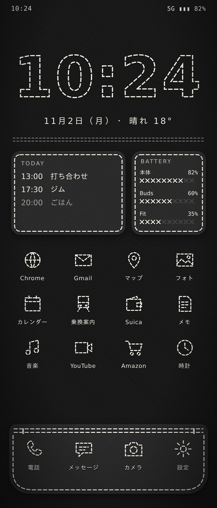
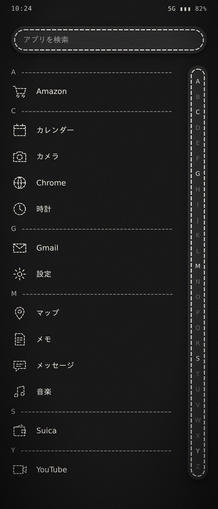

# FlipHome

Galaxy Z Flip7 のメイン画面用の、自作のホームアプリ（ランチャー）です。
見た目は「黒い布地に白い糸のステッチ」。カバー画面用の [FlipCover](https://github.com/Yukichi006/flip7-cover) の姉妹アプリです。

<p>
  
  
</p>

（デザイン案。元の HTML は `docs/mock.html`）

## 仕組み
- Android の「ホームアプリ」として動きます（ユーザー補助の許可は不要）
- 画面はすべてコードで描いています。布地は綾織りの目とざらつきを小さなタイルに描いて敷き詰め、縫い目は影つきの点線で描きます
- ライブラリは使わず、Android の標準機能と Kotlin だけで作っています
- アプリの ID は `io.github.yukichi006.fliphome`。必要以上の権限は持たない（下の「セキュリティ」を参照）

## できること
- **片手の画面**（0.11.0 から最初はこちら）：右手で持って、親指の届く範囲で使えるようにした画面
  - **情報のマス目**：画面全体が 5 列のマス目（マスの大きさは、マス目の画面の 5 列と同じくらい。行の数は画面の高さで決まる）。右下にアプリのパネルが重なり、その上と左の空いたマスに、左右をまたいで部品を置ける。最初は左の 2 列に時計と日付・月のカレンダー・天気・電池（2×2 ずつ）、右上に日付と今日の予定
    - 編集モードで、右下のつまみで大きさ（1×1・2×2・3×2 など）を変えたり、ドラッグで動かしたり、空いたマスに部品を足したりできる
  - **アプリのパネル**：右下の 3 列。パッドを 1 段に 3 つ並べた布。アプリが少ないときは、親指の届く下の段から並ぶ
  - **アプリの枠の高さ**：編集モードでパネルの上の縁に出る「つまみ」を上下にドラッグすると、段の数が変わる（上の部品にぶつかるところまで広げられる。部品は隠さない）。アプリは下にそろえたまま動き、入りきらないアプリは空いたマスか新しい布へ移る（「…」→「アプリの枠の高さ」でも選べる）
  - **パネルをめくる**：パネルの左下の角が少しめくれている。そこをつまんで右上へめくり、めくりきって離すと次の布が出る（最後の布の次は 1 枚目に戻る）。めくっている間は、下に次の布が見える。めくる向きは 8 方向から選べる
  - **アプリ一覧（2 ページ目）**：画面を左へスワイプすると、右からアプリ一覧が出てくる。検索欄は親指の届く下にある。右へスワイプで閉じる
  - **下段のポケット**：マス目の画面と同じジーンズのポケットに、よく使うアプリを 4 つ（中身はマス目の画面と共通）
  - **口のファスナー**：ポケットの口が横向きのファスナーになっている。左端の引き手をつまんで右へ引くと、引き手が通ったところが V の字に開いて、すき間から裏地とアプリの四角がのぞく。右端の近くまで開いて離すとアプリ一覧に切り替わる。途中で離すと閉じる。タップすると少しだけ開いて、引けることを知らせる（編集モードの「…」→「下段のファスナー（アプリ一覧）を外す／付ける」）
  - 編集モードの「…」→ 右のパネルに布を足す・この布を外す・アプリの枠の高さ・パネルをめくる向き・下段のポケットを出す／隠す・マス目の画面にする（今までの画面に戻す）
  - アプリ一覧でアプリを長押し → 「パネルに追加」（今見ている布から空いたマスを探す）
- **マス目のホーム画面**（「…」→「マス目の画面にする」で戻せる。今までの配置はそのまま残る）：横の列（3〜6）× 縦の行（4〜12）のマス目に部品を並べる。最初は 5 列 × 8 行
- **ページ**：左右へスワイプで移る。下の点（今のページは糸の玉）をタップしても移れる。移った先のページは、ワッペンの縁がミシンで縫われるように端から縫い上がる
- **部品**
  - **パッド**（1 マス）：ワッペンに載せたアプリ。刺繍アイコンと小さなアプリ名
    - タップで開く。**裏地のアプリ**を決めておくと、パッドの端が少しめくれる。そこをつまんでめくると裏地に縫い付けたアプリが見え、めくりきって離すと開く
    - めくる向きは 8 方向から選べる（最初は「上から下」。角から始める向きは角を斜めに、辺から始める向きは辺をまっすぐ折り返す）
    - 通知が来ていると、縁の縫い目が**オレンジの糸**に変わり、右上に件数を刺繍した**オレンジの布タグ**が下がる（10 件以上は「9+」。新しい通知が来るとタグが揺れる。「通知へのアクセス」を許可したとき）
  - **巾着**（1 マス）：フォルダ。紐で口を絞った巾着袋の形。タップすると紐がゆるんで口が開き、中のアプリが袋から飛び出して、すぐ上に並ぶ。閉じると袋の中へ戻る。ページを移ると少し揺れる。中のアプリの通知は、件数を合わせて紐の先のタグに出る
  - **アナログ時計**（2×2）：カバー画面の FlipCover と同じ、フェルトの丸いワッペンに縫い付けた文字盤。今の分まで縫い進めた糸目、× のクロスステッチの目盛り、サテン刺繍の時針、縫い針の秒針。タップでアラーム
  - **時計と日付**：数字の輪郭をステッチで縫った大きな時計と日付。タップでアラーム
  - **今日の予定**：今日これからの予定。タップでカレンダー（初回は許可を求める）
  - **電池**：本体と Bluetooth 機器の残量を、大きな数字（%）と、サテン刺繍のように糸で埋めた棒で表示。20% 以下は「残りわずか」、充電中は「充電中」と添える
  - **フェーダー**：縦のファスナーの形。引き手を上下に動かす
    - 音量（VOL）：タップで消音の切り替え
    - 明るさ（BRT）：タップで自動調整の切り替え（「システム設定の変更」の許可が要る）。自動のときは、下の文字が「AUTO」になり、引き手の縫い目がオレンジになる（クイック設定で切り替えても、すぐに変わる）
    - アプリ（APP）：真ん中で待つバネ。上端・下端まで倒すと、決めておいたアプリが開く
  - **時刻**：時刻だけ（秒も出せる）。寄せ方を 9 か所から選べる
  - **日付**：「11月2日（月）」か「11.02 MON」。寄せ方を選べる
  - **月のカレンダー**：今月を刺繍の点で。左上に小さく月の名前、糸の玉の中に日付を布の色でささやかに抜く。土日と祝日（振替休日・国民の休日も。インターネットは使わず計算する）は、通知と同じオレンジの糸。過ぎた日は薄く、今日は輪つき。タップでカレンダー。上下左右のスワイプに「通知を開く」「アプリ一覧を開く」「アプリを開く」を割り当てられる。週の始まりは日曜・月曜を選べる
  - **見出し**：ページの名前など。文字の下に縫い目の線
  - **天気**：天気の刺繍アイコン、13 個の目盛りの温度計（-10〜40℃、いちばん上の目盛りは × に縫う）、今日の最高・最低、今の気温。地点は地名で探して選ぶ（位置情報の権限は使わない）。30 分ごとに取り直し、タップで取り直す（タップで開くアプリも決められる）。天気の文字（晴れ時々くもり など）は、部品の幅に入るときだけ書く（細いときは書かずに、温度計を大きくする）
  - **再生中の曲**：曲名と、前へ・再生／一時停止・次へ（「通知へのアクセス」の許可が要る）。曲名だけを上に、ボタンを下に置き、重ならないように文字の大きさを合わせる（歌手名は出さない）。再生しているときは、一時停止のボタンがオレンジの糸になる。再生していないときは、枠とボタンだけ
- **下段のポケット**：ジーンズのポケット風の下段に、よく使うアプリを 4 つ（隠すこともできる）
- **ステッチの枠**：時計・日付・時刻・見出し・カレンダー・天気・今日の予定・電池・再生中の曲・フェーダーは、部品ごとにステッチの枠（ワッペン）を付けるかどうかを選べる（編集モードで部品をタップ →「ステッチの枠をなくす／付ける」）。枠をなくすと、その分だけ中身が大きくなる
- **アプリ名**：パッドのアプリ名の出し方を、「…」→「パッドのアプリ名」で選べる
  - 出す（長い名前は 2 行）：省略しない。長い名前は文字を少し小さくし、それでも入らなければ 2 行に分ける（空白や、英字と日本語の境目で分け、1 文字だけが 2 行目に落ちないようにする）
  - 1 行だけ：入らない分は「…」。アイコンが少し大きくなる
  - 出さない：アイコンだけを大きく
  - パッドごとにも選べる（編集モードでパッドをタップ →「このパッドのアプリ名を隠す／出す」）。文字は縫い目にかからないように収める
- **編集モード**：どこかを長押しすると入る。マス目にチャコペンのような薄い縫い線が出る
  - 空いたマスをタップ → 下から出るパネルで「アプリ」か「部品」を選んで置く
  - ドラッグで移動、右上の × で外す、右下のつまみで大きさを変える
  - パッドをタップ → アプリを変える、裏地のアプリ、名前を変える、アイコンを変える、別のページへ移す、外す
  - 巾着をタップ → 中のアプリを選ぶ、名前を変える、別のページへ移す、外す
  - 上の帯の「…」 → ページの追加・削除、列と行の数、下段のポケットの表示、裏地をめくる向き、糸の太さ、通知の印の設定
- **糸の太さ**：4 段階（太い〈最初の太さ〉・ふつう・細い・とても細い）。ステッチ・アイコン・時計の数字など、すべての縫い目の太さが変わる
- **ロック画面の壁紙**：黒い布地に、縁のステッチと、刺繍の月のカレンダー（今日の印・土日祝のオレンジ・点の中の日付）。上の 3 割ほどは Galaxy の時計（本物の時刻で動く）のために空けてある
  - **自動**：編集モードの「…」→「ロック画面の壁紙を刺繍にする（毎日自動で更新）」。ロック画面の壁紙に直接設定し、日付が変わるたびに描き直す（日付の変わり目の予約と、FlipHome を開いたときの確かめの両方で）。「…」→「ロック画面の刺繍の壁紙をやめる」で、ホーム画面と同じ壁紙に戻る
  - MPC の「端末ロック画面の壁紙（ドットカレンダー）」を ON にしていると、MPC の絵に上書きされるので OFF にしておく
  - 変わらないときは「…」→「ロック画面の壁紙の状態を調べる」。ロック画面とホーム画面に何が設定されているか（ほかのアプリの動く壁紙なら、そのアプリの名前）を出す
  - **手動**（自動でうまく変わらないとき）：「…」→「ロック画面の壁紙を保存して自分で設定する…」。ギャラリーの「Pictures/FlipHome」に保存され、Galaxy の「壁紙に設定」の画面が開く。ひと月使えるよう「今日」の印は付けない
- **画面の縁**：画面全体を、画面の角の丸みに沿ってステッチでぐるりと囲む
- **刺繍アイコン**：33 種類の手作りの刺繍アイコン。どの絵にするかはアプリ名から自動で推し量り、選び直せる
  - **アイコンの描き方**：アプリごとに「ジャンルのアイコン」か「アプリのアイコンをなぞる」を選べる（パッドの設定の「アイコンの描き方」では、どちらの絵になるかを見比べて選べる。アプリ一覧の長押しでも切り替えられる）
  - 「アプリのアイコンをなぞる」は、アプリ本来のアイコンの形を読み取り（白黒用のアイコンがあればその形、なければ色の明るさで図柄を分ける）、その輪郭を細い糸の短い縫い目で縫う（アイコンの土台の角の丸い四角や丸の外枠は縫わず、中の絵を大きく縫う）。糸は、なぞった線のまわりのアイコンの色にする（Slack や Gmail のように何色も使うアイコンは、形ごと・色の変わる所ごとに糸の色を替える。鮮やかな色がない所は生成り）。「…」→「なぞる刺繍の糸」で、すべて生成りにもできる。作った絵は覚えておき、アプリを更新したり糸の太さを変えたりすると作り直す。形が読み取れないときは、アプリ名の最初の 1 文字を縫う
- **MPC の配置の読み込み**：MPC で書き出した配置ファイル（mpc-layout-*.json）を選ぶと、同じ配置を布と糸で再現する（編集モードの「…」→「MPC の配置を読み込む…」）
  - パッド（下に引くアプリは裏地のアプリに）・巾着（MPC のノブ）・フェーダー・時計・日付・ドットカレンダー（スワイプの割り当てと週の始まりも）・見出し・再生中の曲・天気（地点も）・アプリ名の付け替えを引き継ぐ
  - 入っていないアプリは飛ばし、読み込む前に一覧で知らせる
- **アプリの名前の付け替え**：パッド・下段・アプリ一覧に、付け替えた名前で出る
- **アプリ一覧**：上へスワイプ（片手の画面では左へスワイプ）で開く。検索と、右端の索引（A〜Z、あ〜わ、他）。長押しでホームや下段に置ける
  - **ジャンルの巾着**：検索欄のそばの切り替えで「あいうえお順」と「ジャンル」を選べる。「ジャンル」では、アプリが次の巾着にまとまる（袋に絵を刺繍、名前の横にアプリの数）。タップすると口が開いて中のアプリが出てくる。最後に選んだほうを覚えておく
    - よく使う（FlipHome から開いた回数の多いアプリ。ほかの巾着にも入る。まだあまり開いていないうちは、ホーム画面と下段のアプリで埋める。自分で入れることもできる）
    - 仕事（オリィ研究所まわり：OriHime・Slack・Notion・freee・SmartHR・Google ドキュメントなど）／連絡／交通・おでかけ／支払い・お金／家庭・くらし／写真・カメラ／買い物・食べ物／音楽・動画・本／ゲーム／AI・ツール／既定アプリ（端末に最初から入っているアプリ）／その他
    - 分け方は、アプリ名やアイコンの絵から自動で決める。仕事・交通・支払い・家庭・写真カメラは、最初から入っているアプリでもそちらを優先する
  - **アプリの設定**：アプリ一覧でアプリを長押しすると、そのアプリの設定が 1 枚にまとまって出る。名前・アイコンの描き方・ジャンルは押したらすぐに変わり、パネルは閉じないので続けて設定できる。置き場所（パネル／ホーム・下段）、アプリを開く、アプリ情報もここから
  - **ジャンルの振り分け**：上の「‹ 前のアプリ」「次のアプリ ›」で、あいうえお順に隣のアプリへ移れるので、ジャンル（入る巾着）を次々に振り分けられる。最初は自動（「おまかせ」）。アイコンの絵は、ジャンルとは別に選べる
  - **アプリ一覧のボタン**：下段のポケットに、ほかのアプリと同じ大きさの「アプリ一覧」のボタン（9 つの四角の刺繍）を置ける。編集モードで下段の枠をタップ →「アプリ一覧のボタン」
- **下へスワイプ**：通知を開く

## これから足したいもの
- 歩数計
- FlipHome 自身の配置の書き出し・読み込み（機種変更・バックアップ用）
- アプリ一覧のフォルダ

## インストールと更新
`main` に push すると GitHub Actions がリリース版の APK をビルドし、[Releases](../../releases) に `fliphome-v<バージョン>.apk` を公開します。

1. [Obtainium](https://github.com/ImranR98/Obtainium) に、このリポジトリの URL を登録する
2. 「インストール」を押す（Galaxy のオートブロッカーは、そのときだけオフにする）
3. FlipHome を開き、上の「タップして、ホームアプリに設定」を押して FlipHome を選ぶ
   - 0.1.0〜0.1.1（アプリの ID が `com.example.fliphome` だった版）を入れていた場合は、先にアンインストールする
   - 元に戻すとき：設定 → アプリ → 標準アプリを選択 → ホームアプリ（または、ホームの何もない所を長押し →「ホームアプリを切り替える」）

### 署名の鍵（上書き更新のため）
リポジトリの Settings → Secrets and variables → Actions に、次の 2 つを登録します。FlipCover と同じ鍵を使う場合は、FlipCover に登録したものと同じ値で構いません。

- `FLIPHOME_KEYSTORE_B64`：鍵ファイル（.jks）を base64 にした文字列
- `FLIPHOME_KEYSTORE_PASSWORD`：鍵のパスワード

鍵の別名（alias）は `flipcover` を使います。未登録のままだと毎回違う鍵で署名され、上書き更新ができません。

## セキュリティ
### アプリ
- **インターネットは天気のためだけ**：つなぐ先は [Open-Meteo](https://open-meteo.com/)（無料で鍵の要らない気象データ）だけで、HTTPS だけを使う（暗号化しない通信は設定で禁止）。送るのは、選んだ地点の緯度・経度と、地点を探すときの地名だけ。予定・電池・アプリ・通知などの情報が外へ送られることはない
- **権限**

| 権限 | 使い道 | 許可 |
|---|---|---|
| カレンダーの読み取り | 「今日の予定」を表示 | タップしたときに確認される（断ってもよい） |
| 付近のデバイス | Bluetooth 機器の電池残量 | タップしたときに確認される（断ってもよい） |
| 通知を開く | 下へスワイプで通知を開く | 確認なし（危険のない権限） |
| 通知へのアクセス | パッドの通知の印と再生中の曲（どのアプリに通知が来ているかと再生中の曲だけを使い、通知の中身は読まない・保存しない） | 自分で設定画面から許可したときだけ（使わなくてもよい） |
| インターネット | 天気（Open-Meteo だけに HTTPS でつなぐ） | 確認なし（天気の部品を置いて地点を選んだときだけ通信する） |
| システム設定の変更 | 明るさのフェーダー（画面の明るさと自動調整のオン・オフだけを変える） | 自分で設定画面から許可したときだけ（使わなくてもよい） |
| 壁紙の設定 | ロック画面の刺繍の壁紙（自動をオンにしたときだけ、ロック画面の壁紙を描き直して設定する。ほかの壁紙は読まない） | 確認なし（危険のない権限） |

- ライブラリを使わず、Android の標準機能と Kotlin だけで作っている（他人のコードが紛れ込む余地を減らす）
- 配る APK は正式版（デバッグできない）ビルド。設定のバックアップも無効にしている

### APK が本物か確かめる
APK は FlipHome 専用の鍵で署名している。証明書の指紋（SHA-256）は次のとおり。
[AppVerifier](https://github.com/soupslurpr/AppVerifier) などで、インストールした FlipHome の指紋がこれと一致するかを確かめられる。

```
39:CD:9E:CC:3C:4B:FE:7D:80:EF:B3:4F:5A:E4:00:BB:34:94:45:A9:0F:3D:86:AB:C9:C7:6E:38:B4:FD:C8:5A
```

Android は、署名の鍵が違う APK での上書き更新を拒むので、一度正しい APK を入れれば、すり替えられた更新は入らない。
各リリースの説明には APK の SHA-256 も載せている。

### ビルドと公開
- GitHub Actions の部品はコミット SHA で固定し、Dependabot が月 1 回更新を提案する
- Gradle 本体は公式のチェックサムで確かめてから使う。部品の取得先も Google・Maven Central に絞っている
- ビルドのジョブは読み取り権限だけ。Releases に書き込めるのは公開のジョブだけ
- 署名の鍵は GitHub の Secrets にだけ置いている
- `main` は、強制上書き（force push）と削除ができないように保護している

### 持ち主がしておくとよいこと
- GitHub アカウントの 2 段階認証（パスキーなど）をオンにする
- 署名の鍵の値は、パスワード管理アプリなどに保管し、人に見せない
- 知らない人からのプルリクエストや Issue の指示は、そのまま取り込まない

## バージョンの付け方
リポジトリ直下の `VERSION` ファイル（`メジャー.マイナー.パッチ`）で決め、リリースのたびに上げる（上げ忘れるとリリースは止まる）。

- **メジャー**：大きな作り直し（設定が引き継がれないなど）
- **マイナー**：新しい機能の追加
- **パッチ**：不具合の修正や見た目の微調整

## ファイルの案内
| ファイル | 中身 |
|---|---|
| `HomeActivity.kt` | ホーム画面の組み立て、スワイプ、長押しメニュー |
| `HomeLayout.kt` | マス目の配置と保存（片手の画面の配置も）、編集モードの操作 |
| `Book.kt` | 片手の画面（情報のマス目に重ねる、めくれるアプリのパネルと、枠の高さのつまみ） |
| `AnalogClock.kt` | アナログ時計（FlipCover から移植） |
| `ZipperDrawer.kt` | 下段のポケットの口のファスナー（右へ開くとアプリ一覧） |
| `Modules.kt` | 時計・今日の予定・アプリのパッド・下段のポケット |
| `BatteryPatch.kt` / `BleBattery.kt` | 電池のワッペン（FlipCover から移植） |
| `Drawer.kt` | アプリ一覧と索引 |
| `GenreIcons.kt` | ジャンルの刺繍アイコンと、アプリのジャンルの推し量り |
| `StitchIcons.kt` | アプリのアイコンをなぞった刺繍アイコン |
| `Shelves.kt` | アプリ一覧の巾着の分け方（ジャンル）と、その推し量り |
| `Holidays.kt` | 日本の祝日の計算（カレンダーの色分け） |
| `AppSettings.kt` | アプリ 1 つの設定（名前・アイコン・ジャンル・置き場所）をまとめたパネル |
| `Pads.kt` | パッド（裏地めくり）・巾着・巾着の吹き出し・下段のポケット・ページの点 |
| `Instruments.kt` | フェーダー・時刻・日付・見出し・月のカレンダー・再生中の曲 |
| `MpcImport.kt` | MPC の配置ファイルの読み込み |
| `Weather.kt` | 天気（Open-Meteo から取ってくる係、温度計、地点を探す欄） |
| `LockArt.kt` | ロック画面の刺繍の壁紙（毎日自動で描き直す／保存して自分で設定する） |
| `Badges.kt` | 通知の印（通知が来ているアプリを数える） |
| `Sheet.kt` | 下から出る設定のパネル（アプリ・部品・アイコンを選ぶ） |
| `Stitch.kt` / `Patch.kt` | 布地・糸・ワッペンの描き方 |
